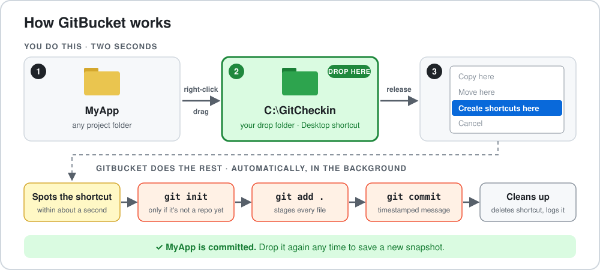

# GitBucket

Automatically commits any folder to Git — no terminal required. Drop a shortcut into a watch folder and GitBucket handles the rest silently in the background.

> [!IMPORTANT]
> **Your drop folder is `C:\GitCheckin`.** That's the folder you drag projects into. `install.bat` creates it, opens it for you, and puts a **GitCheckin** shortcut on your Desktop so it's always one click away.



---

## How It Works

GitBucket watches `C:\GitCheckin` (plus any other drop folders you add, see below) for Windows shortcut files. When you drop a shortcut to a project folder there, it:

1. Initializes a Git repo in that folder (if one doesn't exist yet)
2. Runs the [safety checks](#safety-checks) and stops if anything shouldn't be committed
3. Stages all files (`git add -A .`)
4. Creates a timestamped commit
5. Deletes the shortcut and shows a Windows notification

---

## Drop Folders on More Than One Drive

You can have a drop folder on every drive you work from, e.g. `C:\GitCheckin` for projects on C: and `D:\GitCheckin` for projects on D:, so the drop folder is always next to your work. One GitBucket watches all of them. List them in `config.json`:

```json
{
  "watchFolders": ["C:\\GitCheckin", "D:\\GitCheckin"]
}
```

Use double backslashes. GitBucket creates any missing folders when it starts. After editing, restart it (log off and on, or run `schtasks /run /tn "GitBucket Watcher"` after ending the running `node.exe`).

---

## Safety Checks

GitBucket commits *everything* in the folder, so before committing it checks what's about to go in. It **refuses** (and changes nothing) if it finds:

- **Secrets:** `.env` files (`.env.example` is fine), `*.pem`, `*.key`, `*.pfx`, `id_rsa`, `credentials*.json` and similar, or text that looks like an API key or token (Anthropic, OpenAI, GitHub, AWS, Google, Slack, Telegram, private keys)
- **Media, models and databases:** video, audio, archives, `.psd`/`.blend`, model weights (`.gguf`, `.safetensors`, `.pt`, `.onnx`, ...), `.db`/`.sqlite`
- **Big files:** images over 1 MB, any file over 10 MB
- **Nested repos:** a folder that's inside another Git repo (drop the outer folder instead)

Files already covered by the folder's `.gitignore` are skipped, so the fix for a refusal is usually to add those files to `.gitignore` and drop the shortcut again. When GitBucket refuses, it leaves the shortcut in the drop folder, shows a notification saying why, and lists every offending file in the log. Delete the shortcut before you drop it again.

To turn the checks off: `"safetyChecks": false` in `config.json`.

---

## Which Branch It Commits To

By default GitBucket commits to whatever branch the folder has checked out. If you'd rather your checkpoints never touch `main`, set:

```json
{ "branch": "dated" }
```

Each day's checkpoints then go on a `checkin-YYYY-MM-DD` branch, created from the branch you were on. If today's branch already exists but you've switched away from it, GitBucket refuses rather than guess. Switch back to it, or merge it first.

---

## Installation

1. Clone or copy this repo to `C:\GitBucket`
2. Right-click `install.bat` → **Run as administrator**

That's it. GitBucket will now start automatically every time you log in.

---

## How to Commit a Folder

> **Important:** You must RIGHT-click drag — not left-click drag. Regular (left) drag will **copy or move** the folder. Right-click drag lets you choose "Create shortcut here".

**Steps:**

1. Open `C:\GitCheckin` (double-click the **GitCheckin** shortcut on your Desktop) in one Explorer window and your project folder in another, so you can see both
2. **Right-click and hold** your project folder
3. Drag it into `C:\GitCheckin`
4. Release — a context menu appears
5. Choose **"Create shortcuts here"**

GitBucket detects the shortcut within a second, commits the folder, and deletes the shortcut automatically. Check `C:\GitBucket\gitbucket.log` to confirm it ran.

---

## Checking the Log

Open `C:\GitBucket\gitbucket.log` to see what happened:

```
[2026-03-08T22:07:05.692Z] Processing: C:\Projects\MyApp
[2026-03-08T22:07:08.272Z] Committed: [master bbaf3ab] GitBucket checkin 2026-03-08 22:07:07
[2026-03-08T22:07:08.273Z] Done. Cleaned up: MyApp - Shortcut.lnk
```

If there was nothing new to commit, you'll see:

```
[2026-03-08T22:07:08.273Z] Nothing to commit in: C:\Projects\MyApp
```

If a safety check stopped it:

```
[2026-03-08T22:09:12.101Z] Processing: C:\Projects\MyApp
[2026-03-08T22:09:12.160Z]   secret file: .env
[2026-03-08T22:09:12.160Z] REFUSED: 1 file(s) not allowed (add them to .gitignore): secret file: .env (shortcut left in place)
```

---

## Uninstallation

Right-click `uninstall.bat` → **Run as administrator**

---

## Requirements

- Windows 10 or later
- [Node.js](https://nodejs.org) installed
- [Git](https://git-scm.com) installed and available in PATH
